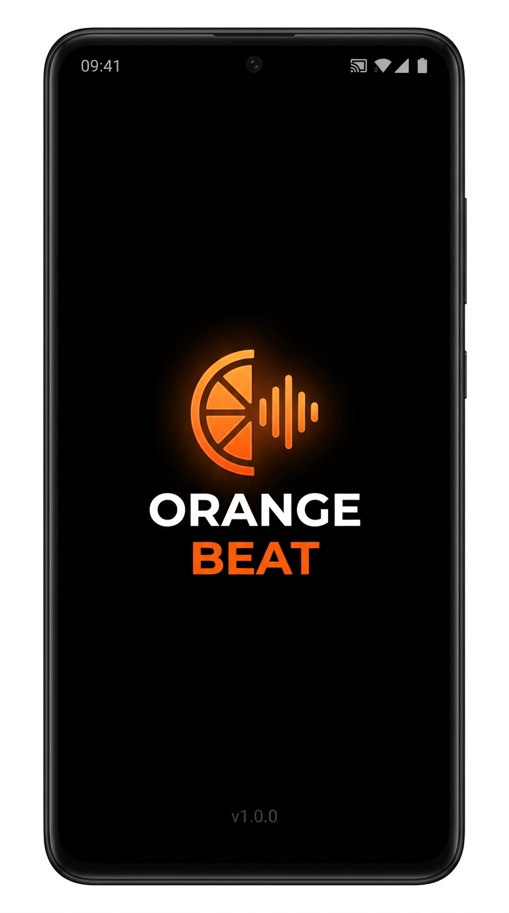
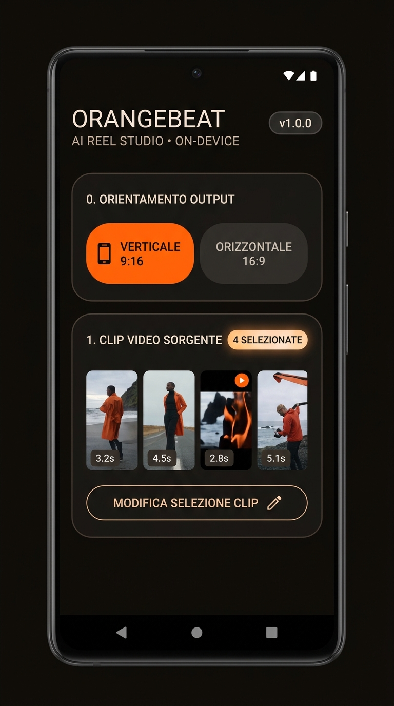
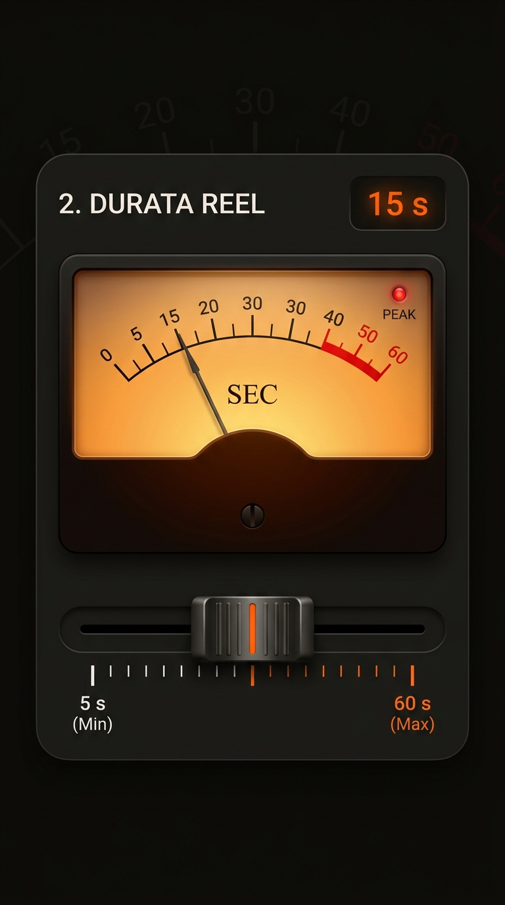
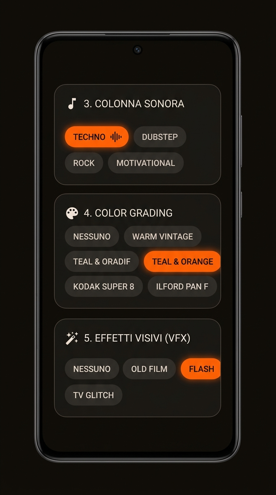
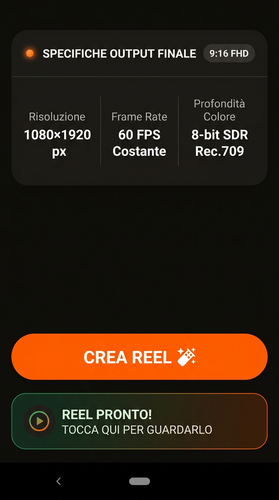
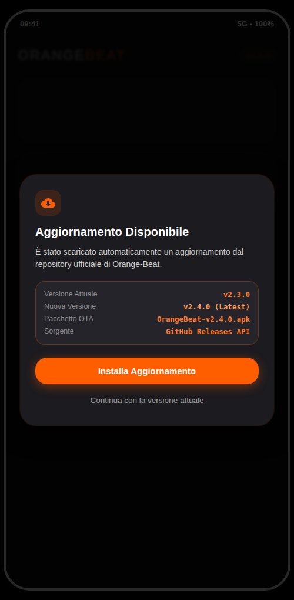
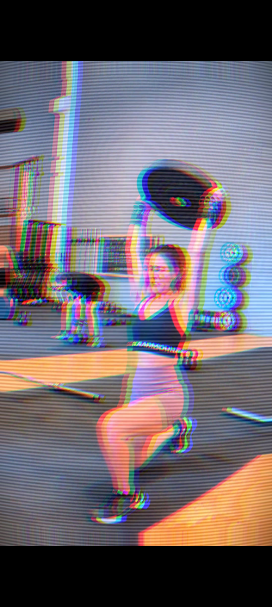

# ORANGE-BEAT 🍊⚡

<p align="center">
  
</p>

<p align="center">
  <strong>Studio di Montaggio Video AI 100% On-Device per Android, Ubuntu e Windows</strong><br>
  <em>Crea Reel sportivi ad alto impatto sincronizzati al millisecondo sul beat musicale reale.</em>
</p>

<p align="center">
  <a href="https://github.com/NewtonH725/OrangeBeat/releases/latest">
    
  </a>
  
  
  
  
  
</p>

---

## 📥 Risorse & Download Rapido (`v3.0.0`)

Tutti i pacchetti eseguibili contengono il numero di versione nel nome e supportano l'**aggiornamento automatico OTA** da GitHub Releases:

* 📱 **Android (`.apk`):** `OrangeBeat-vX.Y.Z-android.apk` — [Scarica Ultima Release](https://github.com/NewtonH725/OrangeBeat/releases/latest)
* 🐧 **Ubuntu / Linux (`.deb`):** `OrangeBeat-vX.Y.Z-ubuntu-amd64.deb` *(richiede `ffmpeg`)* — [Scarica Ultima Release](https://github.com/NewtonH725/OrangeBeat/releases/latest)
* 🪟 **Windows (`.msi`):** `OrangeBeat-vX.Y.Z-windows-x64.msi` *(richiede `ffmpeg` nel `PATH`)* — [Scarica Ultima Release](https://github.com/NewtonH725/OrangeBeat/releases/latest)
* 📄 **Guida Tecnica Ufficiale (PDF Completo, 14 pagine illustrate):**  
  * [Visualizza / Scarica PDF dal Repository (`./docs/OrangeBeat-Guida-Completa.pdf`)](./docs/OrangeBeat-Guida-Completa.pdf)  
  * [Download Diretto Raw GitHub (`OrangeBeat-Guida-Completa.pdf`)](https://github.com/NewtonH725/OrangeBeat/raw/main/docs/OrangeBeat-Guida-Completa.pdf)

---

## ⚡ Caratteristiche Principali

* **100% On-Device & Privacy Assoluta:** Zero cloud, zero caricamento video su server esterni, zero credenziali API, zero abbonamenti. L'elaborazione e il montaggio avvengono interamente sul chip dello smartphone.
* **Dual-Format Output (9:16 & 16:9):** Esportazione immediata in **Verticale 9:16 (1080×1920)** per Instagram Reels, TikTok e YouTube Shorts, oppure in **Orizzontale 16:9 (1920×1080)** per YouTube, TV e monitor da palestra.
* **Smart Audio Director (`SmartAudioDirector.kt`):** Motore di intelligenza contestuale che analizza l'energia cinetica del video, i picchi delle pose, i filtri colore e gli effetti VFX scelti per selezionare la traccia musicale perfetta ed eliminare le intro lente (Drop-Hunting).
* **Motore Audio Cloud-First con Fallback Locale (`RemoteAudioManager.kt`):** Catalogo musicale dinamico da GitHub Raw CDN (`catalog.json`) con caching atomico su disco e fallback istantaneo trasparente sul bundle offline locale (`res/raw/`, 16 tracce originali Drop-Hunter).
* **Rilevamento Beat Fisico a Basso Livello (`RealBeatDetector.kt`):** Decodifica hardware dei flussi audio in PCM 16-bit a 44.1 kHz via `MediaCodec`, filtro digitale passa-basso IIR a 160 Hz (isolamento kick drum) e calcolo dell'energia RMS su finestre mobili a 50 ms.
* **Computer Vision & Pose Tracking On-Device:**
  * `MotionAnalyzer.kt`: Analisi energetica via Sum of Absolute Differences (SAD) a 64×64 pixel con riciclo immediato Bitmap (anti-OOM).
  * `PoseActionFinder.kt`: Tracciamento scheletrico tramite Google ML Kit Pose Detection a 480×270 pixel per identificare salti, squat, jerk ed estensioni pliometriche ($\Delta Y / \Delta t$).
* **Regia Deterministica a 5 Fasi (`AiDirector.kt`):** Scomposizione ritmica in `INTRO`, `BUILDUP`, `DROP`, `BREAKDOWN` e `CLIMAX`. Sincronizzazione millimetrica dei tagli sui beat e applicazione di Speed Ramping (0.8x slow-motion e 1.25x fast-forward).
* **Pipeline Hardware AndroidX Media3 Transformer (`VideoEditor.kt`):** Presentation scaling first, matrici cromatiche $4 \times 4$ `RgbMatrix`, zoom dinamico `KenBurnsMatrix`, shaders GLSL personalizzati (Old Film, TV Glitch CRT con aberrazione cromatica, Flash reattivo) e controllo DSP audio (`VolumeAudioProcessor.kt` con fade-in 500ms e fade-out 1500ms).
* **Auto-Aggiornamento Integrato OTA (`AppUpdater.kt` / `DesktopAppUpdater.kt`):** Ispezione silente all'avvio da GitHub Releases API su tutte e tre le piattaforme, download atomico del pacchetto versionato (`.apk` su Android, `.deb` su Ubuntu, `.msi` su Windows) e installazione assistita.

---

## 🧩 Struttura Multi-Piattaforma

* **`:shared`**: Core comune Kotlin (`AiDirectorCore`, `BeatDspCore`, `MotionSadCore`, `ColorPreset`, `VfxPreset`, `OutputOrientation`, `ReleaseUpdaterCore`).
* **`:app` (Android)**: Jetpack Compose Material 3, Media3 Transformer, ML Kit Pose Detection, OpenGL ES 2.0 Shaders, `MediaCodec`.
* **`:desktop` (Ubuntu & Windows)**: Compose Multiplatform (JVM), analisi e rendering `FFmpeg` / `FFprobe` 100% offline, pacchettizzazione nativa `.deb` e `.msi`.

---

## 📱 Galleria Interfaccia Utente

<table align="center">
  <tr>
    <td align="center" width="33%">
      <br>
      <b>1. Splash Screen OLED</b><br>
      <em>Avvio Pure Black & controllo OTA</em>
    </td>
    <td align="center" width="33%">
      <br>
      <b>2. Formato & Clip</b><br>
      <em>Scelta 9:16/16:9 & PhotoPicker</em>
    </td>
    <td align="center" width="33%">
      <br>
      <b>3. VU Meter Vintage</b><br>
      <em>Fader analogico e lancetta Canvas</em>
    </td>
  </tr>
  <tr>
    <td align="center" width="33%">
      <br>
      <b>4. Colonna Sonora, Color & VFX</b><br>
      <em>Preset cinematografici e filtri M3</em>
    </td>
    <td align="center" width="33%">
      <br>
      <b>5. Specifiche & Esportazione</b><br>
      <em>FHD 60 FPS e tasto Crea Reel</em>
    </td>
    <td align="center" width="33%">
      <br>
      <b>6. Popup Aggiornamento OTA</b><br>
      <em>Download automatico GitHub Releases</em>
    </td>
  </tr>
</table>

<p align="center">
  <br>
  <em>Rendering effettivo del fotogramma con lo shader <strong>TV Glitch</strong> (aberrazione cromatica RGB e scanlines CRT).</em>
</p>

---

## 🏗️ Architettura del Flusso Operativo

```
[ Clip Video Grezze (Galleria) ]
               │
               ▼
   MediaMetadataRetriever (Durata & Dimensioni)
               │
       ┌───────┴───────┐
       ▼               ▼
[ MotionAnalyzer ]   [ PoseActionFinder ]
(SAD 64×64 Pixel)    (ML Kit Pose ΔY)
(Energia Cinetica)   (Picchi di Salto/Squat)
       │               │
       └───────┬───────┘
               ▼
    [ SmartAudioDirector ]
 (Scoring Matrice: VFX + Color + Cinetica)
               │
       ┌───────┴───────┐
       ▼               ▼
[ RemoteAudioManager ] [ RealBeatDetector ]
(GitHub Raw CDN)       (MediaCodec PCM 16-bit)
(Fallback res/raw/)    (Filtro Passa-Basso 160 Hz)
       │               │
       └───────┬───────┘
               ▼
        [ AiDirector ]
 (5 Fasi: INTRO -> BUILDUP -> DROP -> BREAKDOWN -> CLIMAX)
 (Tagli Ritmici sui Beat + Speed Ramping 0.8x/1.25x)
               │
               ▼
        [ VideoEditor ]
 (AndroidX Media3 Transformer Hardware Pipeline)
  ├── 1. Presentation (1080×1920 / 1920×1080 Crop-to-Fit)
  ├── 2. ColorPreset (Matrici 4×4 RgbMatrix)
  ├── 3. KenBurnsMatrix (Zoom Dinamico 1.0x → 1.15x)
  ├── 4. VfxEffect (Shader OpenGL ES 2.0 #version 100)
  └── 5. VolumeAudioProcessor (16-bit PCM Fade-Out 1500ms)
               │
               ▼
[ Video MP4 Esportato in Galleria / Movies ]
```

---

## 🛠️ Stack Tecnologico

| Componente | Tecnologia | Scopo / Dettagli |
| :--- | :--- | :--- |
| **Linguaggio** | Kotlin 2.2.10 | Target JVM Java 17, K2 Compiler, Coroutine asincrone |
| **Target SDK** | compileSdk 37 • targetSdk 37 • minSdk 35 | Pieno supporto ad Android 15 e Android 16 (Baklava), ELF a 16 kB |
| **Interfaccia Grafica** | Jetpack Compose • Material 3 Expressive | Palette Dark OLED Pure Black (`#000000`), controlli Canvas hardware |
| **Video Engine** | AndroidX Media3 Transformer 1.4.1 | Multiplexing video/audio, clipping millisecond-accurate, GLSL Shaders |
| **Pose Detection** | Google ML Kit Pose Detection 17.0.0 | Modello base rapido single-image, tracciamento 33 landmark scheletrici |
| **Low-Level Audio** | Android `MediaCodec` & `MediaExtractor` | Decodifica stream compresso in campioni raw PCM a 44.1 kHz |
| **Grafica Hardware** | OpenGL ES 2.0 (`#version 100`) | Shader personalizzati per distorsione CRT, grana pellicola e flash |
| **Auto-Update OTA** | GitHub REST API & `FileProvider` | Controllo semantico delle versioni e installazione pacchetti APK |

---

## 🚀 Compilazione & Installazione

### Prerequisiti
* Java Development Kit (JDK) 17+
* Android SDK Platform 35 o 37 con Build-Tools aggiornati
* Gradle 8.13+ (tramite `./gradlew`)

### Build da Riga di Comando
```bash
# 1. Android (Debug APK)
./gradlew :app:assembleDebug

# 2. Avvia la versione Desktop in locale (Ubuntu / Windows)
./gradlew :desktop:run

# 3. Pacchetto Ubuntu (.deb) — richiede JDK 17/21 con jpackage
./gradlew :desktop:packageDeb

# 4. Installer Windows (.msi) — su Windows, richiede JDK 17/21 con jpackage
.\gradlew.bat :desktop:packageMsi
```

---

## 🎵 Catalogo Musicale Drop-Hunter

Ogni brano è sincronizzato tramite l'algoritmo **Drop-Hunter** per eliminare le intro lente e colpire il primo beat energico:

* **TECHNO:** `techno_01` (133 BPM), `techno_02` (100 BPM), `techno_03` (133 BPM), `techno_04` (120 BPM)
* **DUBSTEP:** `dubstep_01` (133 BPM), `dubstep_02` (109 BPM), `dubstep_03` (133 BPM), `dubstep_04` (171 BPM)
* **ROCK:** `rock_01` (80 BPM), `rock_02` (150 BPM), `rock_03` (92 BPM), `rock_04` (133 BPM)
* **METAL:** `metal_01` (86 BPM), `metal_02` (86 BPM), `metal_03` (150 BPM), `metal_04` (86 BPM)
* **MOTIVATIONAL:** `motivational_01` (133 BPM)

---

## 📄 Licenza & Crediti

Sviluppato con passione da **Marco Newton** per la community CrossFit e content creator.  
Repository Ufficiale: [github.com/NewtonH725/OrangeBeat](https://github.com/NewtonH725/OrangeBeat)
