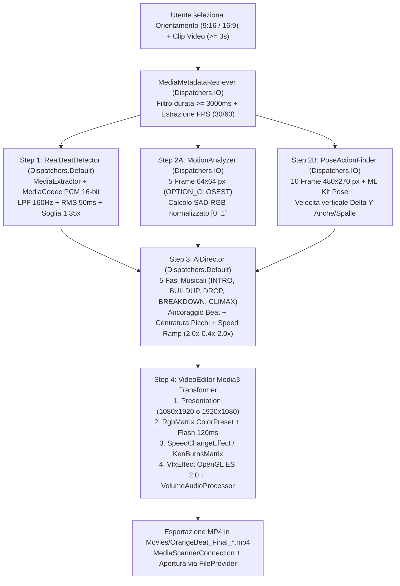
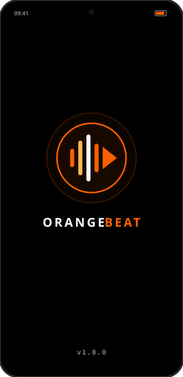
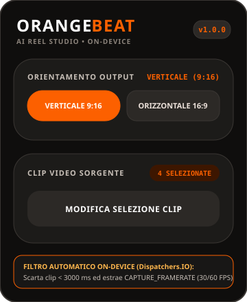
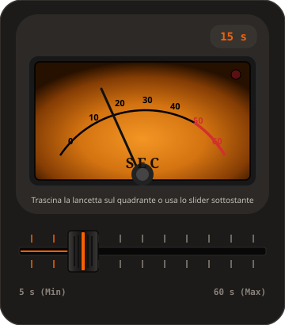
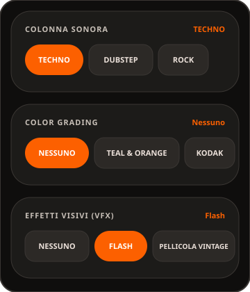
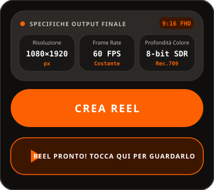
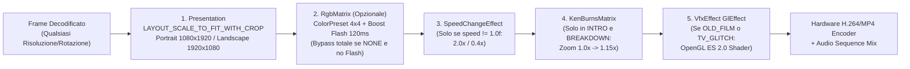

# ORANGE-BEAT (`v1.0.0`) — Snapshot Tecnico Completo & Manuale Utente Illustrato

> **Release Base Ufficiale:** `v1.0.0` (`versionCode = 10000`)  
> **Namespace & Application ID:** `com.example.crossreel`  
> **Piattaforma Target:** Android Nativo (`minSdk 35` / `targetSdk 37` / `compileSdk 37`, Kotlin `2.2.10`, JVM Target `Java 17`)  
> **Paradigma Architetturale:** **100% On-Device & Offline AI Video Studio** (Zero Cloud, Zero API Key, Zero Latenza di Rete, Privacy Totale)

---

## Indice Generale

1. [Panoramica & Filosofia di Progetto (`v1.0.0`)](#1-panoramica--filosofia-di-progetto-v100)
   - [1.1 Architettura 100% On-Device & Offline](#11-architettura-100-on-device--offline)
   - [1.2 Protocollo Ufficiale di Versionamento Semantico (`vX.Y.Z`)](#12-protocollo-ufficiale-di-versionamento-semantico-vxyz)
2. [Manuale Utente Illustrato (Guida alle Schermate)](#2-manuale-utente-illustrato-guida-alle-schermate)
   - [2.1 Schermata 1 — Splash Screen (`#000000` OLED Pure Black)](#21-schermata-1--splash-screen-000000-oled-pure-black)
   - [2.2 Schermata 2 — Header, Sezione 0 (Orientamento Output) & Sezione 1 (Clip Video Sorgente)](#22-schermata-2--header-sezione-0-orientamento-output--sezione-1-clip-video-sorgente)
   - [2.3 Schermata 3 — Sezione 2 (Strumento Analogico VU Meter Vintage & Fader da Mixer)](#23-schermata-3--sezione-2-strumento-analogico-vu-meter-vintage--fader-da-mixer)
   - [2.4 Schermata 4 — Sezioni 3, 4 e 5 (Colonna Sonora, Color Grading, Effetti VFX)](#24-schermata-4--sezioni-3-4-e-5-colonna-sonora-color-grading-effetti-vfx)
   - [2.5 Schermata 5 — Riquadro `OutputSpecsSummaryCard`, CTA `CREA REEL` & Apertura Rapida](#25-schermata-5--riquadro-outputspecssummarycard-cta-crea-reel--apertura-rapida)
3. [Stack Tecnologico & Design System Material 3 Expressive](#3-stack-tecnologico--design-system-material-3-expressive)
   - [3.1 Toolchain di Compilazione & Librerie Core](#31-toolchain-di-compilazione--librerie-core)
   - [3.2 Palette Colori Material 3 Expressive Dark (`Color.kt`)](#32-palette-colori-material-3-expressive-dark-colorkt)
   - [3.3 Tipografia & Numeri Tabulari Anti-Jitter (`Type.kt` & `Theme.kt`)](#33-tipografia--numeri-tabulari-anti-jitter-typekt--themekt)
4. [Logiche Matematiche & Algoritmi di Analisi Audio/Video On-Device](#4-logiche-matematiche--algoritmi-di-analisi-audiovideo-on-device)
   - [4.1 `RealBeatDetector.kt` — Decodifica PCM 16-bit, Filtro Passa-Basso 160 Hz & Rilevamento Beat RMS](#41-realbeatdetectorkt--decodifica-pcm-16-bit-filtro-passa-basso-160-hz--rilevamento-beat-rms)
   - [4.2 `MotionAnalyzer.kt` — Energia Cinetica via SAD (Sum of Absolute Differences) a 64×64 px](#42-motionanalyzerkt--energia-cinetica-via-sad-sum-of-absolute-differences-a-6464-px)
   - [4.3 `PoseActionFinder.kt` — Tracciamento Scheletrico ML Kit a 480×270 px & Velocità Verticale $\Delta Y$](#43-poseactionfinderkt--tracciamento-scheletrico-ml-kit-a-480270-px--velocit-verticale-delta-y)
   - [4.4 `AiDirector.kt` — Motore di Regia Deterministico, 5 Fasi Musicali & Speed Ramping](#44-aidirectorkt--motore-di-regia-deterministico-5-fasi-musicali--speed-ramping)
5. [Pipeline di Rendering Hardware AndroidX Media3 & Shaders OpenGL ES 2.0](#5-pipeline-di-rendering-hardware-androidx-media3--shaders-opengl-es-20)
   - [5.1 `VideoEditor.kt` — Catena degli Effetti Media3 Transformer (`Presentation` First)](#51-videoeditorkt--catena-degli-effetti-media3-transformer-presentation-first)
   - [5.2 `ColorPreset.kt` — Matrici 4×4 Column-Major `RgbMatrix` e Bypass Nativo](#52-colorpresetkt--matrici-44-column-major-rgbmatrix-e-bypass-nativo)
   - [5.3 `KenBurnsEffect.kt` — Zoom Cinematografico 1.0x → 1.15x a Zero Allocazioni](#53-kenburnseffectkt--zoom-cinematografico-10x--115x-a-zero-allocazioni)
   - [5.4 `VfxEffect.kt` & Shaders GLSL (`#version 100`) — Flash, Pellicola Vintage e VHS Glitch](#54-vfxeffectkt--shaders-glsl-version-100--flash-pellicola-vintage-e-vhs-glitch)
   - [5.5 `VolumeAudioProcessor.kt` — Guadagno Unitario PCM 16-bit & Fade-Out Lineare di 1500 ms](#55-volumeaudioprocessorkt--guadagno-unitario-pcm-16-bit--fade-out-lineare-di-1500-ms)
   - [5.6 `ErrorLogger.kt` — Diagnostica Persistente Scoped Storage](#56-errorloggerkt--diagnostica-persistente-scoped-storage)

---

## 1. Panoramica & Filosofia di Progetto (`v1.0.0`)

**Orange-Beat** è uno studio di montaggio video automatizzato progettato per atleti, coach, box CrossFit e content creator che desiderano trasformare clip grezze girate dallo smartphone in Reel ad alto impatto ritmico, sincronizzati al millisecondo ai battiti musicali reali.

### 1.1 Architettura 100% On-Device & Offline

A differenza delle soluzioni cloud o basate su LLM remoti, **Orange-Beat (`v1.0.0`)** opera con un'architettura **100% locale e autonoma**:
- **Zero Cloud & Zero API Key:** Nessun fotogramma né metadato viene mai caricato su server esterni. Non occorre alcuna chiave API né abbonamento a servizi terzi.
- **Zero Latenza di Upload:** Video 4K/1080p a 60fps da centinaia di megabyte vengono analizzati direttamente nella memoria locale tramite campionamento scalato (`64×64` per la motion analysis e `480×270` per la pose detection), eliminando i colli di bottiglia della rete mobile.
- **Prevenzione Sistematica di Out-Of-Memory (OOM):** L'intera pipeline di analisi usa `MediaMetadataRetriever.getScaledFrameAtTime(timeUs, OPTION_CLOSEST, width, height)` con riciclo immediato delle `Bitmap` (`bitmap.recycle()`), abbattendo del 95% il consumo dell'heap nativo su clip 4K.
- **Zero Allocazioni nei Loop a 60/120 Hz:** Sia i controlli custom su `Canvas` (`MixerKnobWithVuMeter`, `ExpressiveDurationSlider`) sia le trasformazioni per-frame di Media3 (`KenBurnsMatrix`, `RgbMatrix`) pre-allocano tutti gli oggetti (`Paint`, `Brush`, `Stroke`, `Matrix`, `FloatArray`) all'esterno dei cicli di disegno/rendering.



### 1.2 Protocollo Ufficiale di Versionamento Semantico (`vX.Y.Z`)

Con il rilascio della versione **`v1.0.0`**, Orange-Beat adotta il protocollo rigoroso di versionamento semantico `vX.Y.Z` definito in [`app/build.gradle.kts`](file:///home/marco/ANTIGRAVITY%20PROJECT/Montatore/app/build.gradle.kts#L10-L24):

$$\text{versionCode} = X \times 10000 + Y \times 100 + Z$$

$$\text{versionName} = \text{"v"} + X + \text{"."} + Y + \text{"."} + Z$$

| Segmento | Variabile Gradle | Regola di Incremento | Esempio |
| :--- | :--- | :--- | :--- |
| **`X` (Major)** | `versionMajor` | Incrementa di `+1` (azzerando `Y = 0` e `Z = 0`) **esclusivamente** quando viene introdotta una **nuova funzionalità** nell'applicazione. | `v1.0.0` $\rightarrow$ `v2.0.0` (`20000`) |
| **`Y` (Minor)** | `versionMinor` | Incrementa di `+1` (azzerando `Z = 0`) per **upgrade sostanziosi e miglioramenti importanti** a funzionalità o architetture esistenti. | `v1.0.0` $\rightarrow$ `v1.1.0` (`10100`) |
| **`Z` (Patch)** | `versionPatch` | Incrementa di `+1` solo per **bug fix, correzioni e upgrade minori**. | `v1.0.0` $\rightarrow$ `v1.0.1` (`10001`) |

La stringa `BuildConfig.VERSION_NAME` (già comprensiva del prefisso `"v"`, es. `"v1.0.0"`) viene letta dinamicamente sia nello `SplashScreen` sia nel badge dell'header principale di `MainScreen`.

---

## 2. Manuale Utente Illustrato (Guida alle Schermate)

### 2.1 Schermata 1 — Splash Screen (`#000000` OLED Pure Black)




All'avvio dell'applicazione ([`SplashScreen()`](file:///home/marco/ANTIGRAVITY%20PROJECT/Montatore/app/src/main/java/com/example/crossreel/MainActivity.kt#L94-L141)), l'utente viene accolto per `2000 ms` da una schermata minimalista progettata per schermi OLED:
- **Sfondo Nero Assoluto (`#000000` / `Color.Black`):** Sia la `Surface` radice sia il contenitore `Box` dello `SplashScreen` adottano il nero puro `#000000` (allineato a `@color/black` di `themes.xml`), eliminando qualsiasi stacco cromatico con il fondo dell'illustrazione [`R.drawable.splash_logo`](file:///home/marco/ANTIGRAVITY%20PROJECT/Montatore/app/src/main/java/com/example/crossreel/MainActivity.kt#L106).
- **Wordmark Bicolore:** Testo `"ORANGE"` in bianco puro (`#FFFFFF`) accostato a `"BEAT"` in **Bull Moose Flame Orange** (`#FC6000`), `FontWeight.Black`, `22.sp`, `letterSpacing = 4.sp`.
- **Indicatore Versione:** In basso al centro (`padding(bottom = 32.dp)`), mostra dinamicamente `BuildConfig.VERSION_NAME` (`v1.0.0`) in colore `TextMuted` (`#8A827A`).

---

### 2.2 Schermata 2 — Header, Sezione 0 (Orientamento Output) & Sezione 1 (Clip Video Sorgente)




Terminato lo splash screen, compare la schermata principale [`MainScreen()`](file:///home/marco/ANTIGRAVITY%20PROJECT/Montatore/app/src/main/java/com/example/crossreel/MainActivity.kt#L144-L815) su sfondo `AppBackground` (`#0F0E0D`):

1. **Header Applicazione M3 Expressive:**
   - Titolo `"ORANGEBEAT"` (`26.sp`, `FontWeight.Black`) con sottotitolo `"AI REEL STUDIO • ON-DEVICE"` (`labelSmall`, `#8A827A`).
   - A destra, badge a pillola (`RoundedCornerShape(12.dp)`, sfondo `SurfaceContainerHigh` `#2C2926`, bordo `OutlineVariantColor` `#3A3633`) con versione `v1.0.0` in stile `TabularNumberStyle` arancione `#FC6000`.
2. **Sezione 0 (Prima Opzione Assoluta) — `ORIENTAMENTO OUTPUT`:**
   - Posizionata come **prima scelta in alto** affinché l'intera catena di elaborazione e il riepilogo finale si adattino immediatamente al formato desiderato.
   - Mostra in alto a destra l'etichetta attiva (`VERTICALE (9:16)` oppure `ORIZZONTALE (16:9)`) e due chip elastici [`ExpressiveFilterChip`](file:///home/marco/ANTIGRAVITY%20PROJECT/Montatore/app/src/main/java/com/example/crossreel/MainActivity.kt#L321-L328) a larghezza paritaria (`Modifier.weight(1f)`):
     - **`VERTICALE 9:16`** (`OutputOrientation.PORTRAIT` — risoluzione target **`1080×1920` px**, ideale per Instagram Reels, TikTok, YouTube Shorts).
     - **`ORIZZONTALE 16:9`** (`OutputOrientation.LANDSCAPE` — risoluzione target **`1920×1080` px**, ideale per YouTube widescreen, display orizzontali in palestra e presentazioni).
3. **Sezione 1 — `CLIP VIDEO SORGENTE`:**
   - Header con contatore dinamico in tempo reale (`NESSUNA` in grigio oppure `"N SELEZIONATE"` su sfondo `PrimaryContainerColor` `#3D1600` e testo `#FC6000`).
   - Pulsante `"SELEZIONA VIDEO DALLA GALLERIA"` (o `"MODIFICA SELEZIONE CLIP"` quando sono già presenti video) che invoca il selettore di sistema `ActivityResultContracts.GetMultipleContents()` filtrato su `"video/*"`.
   - **Filtro Automatico Anti-Clip Brevi & Rilevamento FPS (`Dispatchers.IO`):**
     - Ogni clip selezionata viene ispezionata in background con `MediaMetadataRetriever`.
     - Le clip con durata **`< 3000 ms` (3 secondi)** vengono **scartate automaticamente** con notifica Toast: *"Le clip inferiori a 3 secondi sono state scartate per garantire un montaggio di qualità."*
     - Dalla prima clip valida viene estratto il frame rate nativo tramite `METADATA_KEY_CAPTURE_FRAMERATE` (o calcolato da `METADATA_KEY_VIDEO_FRAME_COUNT / duration` e normalizzato a `30` o `60` FPS, con fallback a `30 FPS`).

---

### 2.3 Schermata 3 — Sezione 2 (Strumento Analogico VU Meter Vintage & Fader da Mixer)




La **Sezione 2** permette di scegliere la durata esatta del video finale tra **5 secondi e 60 secondi** (`range = 5..60`, default `15 s`) attraverso una doppia interfaccia ispirata ai banchi studio analogici professionali:

1. **Quadrante Analogico Vintage [`MixerKnobWithVuMeter`](file:///home/marco/ANTIGRAVITY%20PROJECT/Montatore/app/src/main/java/com/example/crossreel/MixerKnob.kt#L60-L345):**
   - **Contatore Digitale Tabulare Integrato:** In alto a destra dentro la cornice dello strumento, un badge (`SurfaceContainerHighest` `#373430`) mostra il valore corrente (es. `15 s`) con font tabulare `tnum` in `#FC6000` (senza scritte ridondanti esterne).
   - **Retroilluminazione Ambra/Arancione Calda:** Il quadrante interno (`height = 165.dp`) è illuminato da un `Brush.radialGradient` pre-allocato con 4 stop cromatici:
     - Centro luminoso ambra calda: `#F39624`
     - Transizione arancione vintage: `#D37311`
     - Bordo caldo brunito: `#853D04`
     - Ombra perimetrale del case: `#261000`
   - **Scala Graduata Bicolore (`-50°` a `+50°`):**
     - **Arco Normale (`0s – 50s`):** Tracciato in nero (`Color.Black`, spessore `2.dp`) con tacche ogni `5s` e cifre serigrafate ogni `10s` (`0, 10, 20, 30, 40`).
     - **Zona di Picco / Warning (`50s – 60s`):** Tracciata in rosso analogico `#D32F2F` (spessore `3.dp`) con cifre `50` e `60` rosse.
   - **Spia LED di Picco:** In alto a destra nel quadrante, un LED circolare (`11.dp`) passa da rosso spento (`#5A1010`) a rosso vivo acceso (`Color.Red`) non appena la durata raggiunge o supera i `50 s`.
   - **Lancetta Fisica & Interazione Touch Polare:** La lancetta (`#111111`) ruota attorno al perno inferiore (`pivotY = size.height * 1.15f`) con fisica elastica smorzata (`spring(dampingRatio = 0.55f, stiffness = 90f)`). L'utente può trascinare direttamente il dito sul quadrante: l'angolo viene calcolato tramite $\theta = \text{atan2}(\Delta x, -\Delta y)$ con feedback aptico `HapticFeedbackType.TextHandleMove` ad ogni secondo.
2. **Fader Orizzontale da Banco Mixer [`ExpressiveDurationSlider`](file:///home/marco/ANTIGRAVITY%20PROJECT/Montatore/app/src/main/java/com/example/crossreel/MainActivity.kt#L972-L1149):**
   - **Fessura Metallica Incassata (Fader Slot):** Scanalatura orizzontale (`10.dp`) con gradiente verticale scuro (`#040404` $\rightarrow$ `#141312` $\rightarrow$ `#060606`), binario centrale nero (`2.dp`) e scia luminosa arancione `#FC6000` lungo la corsa attiva.
   - **Serigrafia Tacche di Calibrazione:** 23 tacche superiori e 23 inferiori (`0..22`), di cui le tacche principali pari si illuminano in `#FC6000` al passaggio del fader.
   - **Tasto Fader 3D Concavo (Fader Cap):** Cursore rettangolare (`38.dp × 52.dp`, angoli `4.dp`, ombra `8.dp`) con gradiente metallico a 7 stop che simula l'incavo ergonomico per il polpastrello, **4 zigrinature nere di presa (Grip Lines)** e **linea di fede centrale intarsiata in Flame Orange `#FC6000`** (`3.5.dp`).

---

### 2.4 Schermata 4 — Sezioni 3, 4 e 5 (Colonna Sonora, Color Grading, Effetti VFX)




Le tre sezioni centrali utilizzano righe scorrevoli orizzontali (`LazyRow`) con chip [`ExpressiveFilterChip`](file:///home/marco/ANTIGRAVITY%20PROJECT/Montatore/app/src/main/java/com/example/crossreel/MainActivity.kt#L1155-L1195) a larghezza intrinseca (`maxLines = 1`, `softWrap = false`, morphing elastico del raggio da `14.dp` a `22.dp` quando selezionati):

1. **Sezione 3 — `COLONNA SONORA` ([`AudioBeatDetector.kt`](file:///home/marco/ANTIGRAVITY%20PROJECT/Montatore/app/src/main/java/com/example/crossreel/AudioBeatDetector.kt)):**
   - **4 Generi Musicali:** `TECHNO`, `DUBSTEP`, `ROCK`, `MOTIVATIONAL`.
   - Il motore seleziona automaticamente una traccia dalla cartella `res/raw/` (17 file audio complessivi) in base al genere scelto e alla fascia di durata (`SHORT <= 20s`, `MEDIUM 21..45s`, `LONG > 45s`):
     - **Techno:** `techno`, `techno2` (Short); `techno3`, `techno6` (Medium); `techno7`, `techno10` (Long).
     - **Dubstep:** `techno2` (Short); `techno3` (Medium); `techno6`, `techno7` (Long).
     - **Rock:** `rock`, `rock4`, `rock5` (Short); `rock6`, `rock7`, `rock8` (Medium); `rock9`, `rock10` (Long).
     - **Motivational:** `motivational` (Short); `techno8`, `motivational` (Medium); `techno9`, `motivational` (Long).
2. **Sezione 4 — `COLOR GRADING` ([`ColorPreset.kt`](file:///home/marco/ANTIGRAVITY%20PROJECT/Montatore/app/src/main/java/com/example/crossreel/ColorPreset.kt)):**
   - **9 Preset Cinematografici:**
     1. **`NESSUNO` (`ColorPreset.NONE`) — Prima Posizione Default:** Disattiva completamente lo stadio `RgbMatrix` nella pipeline Media3 (quando non è attivo il Flash), preservando al 100% i colori nativi della fotocamera e massimizzando la velocità di esportazione.
     2. **`TEAL & ORANGE` (`ColorPreset.TEAL_ORANGE`):** Contrasto cinematografico CrossFit con ombre fredde ottanio e incarnati caldi arancioni.
     3. **`KODAK SUPER 8` (`ColorPreset.KODAK_SUPER_8`):** Calore analogico anni '70 con dominanti ambrate e neri morbidi.
     4. **`ILFORD PAN F` (`ColorPreset.ILFORD_PAN_F`):** Bianco e nero monocromatico ad alto contrasto con pesi di luminanza standard ($0.30 R + 0.59 G + 0.11 B$).
     5. **`BLEACH BYPASS` (`ColorPreset.BLEACH_BYPASS`):** Look metallico desaturato a ritenzione d'argento con neri incisivi.
     6. **`PORTRA 400` (`ColorPreset.PORTRA_400`):** Toni pastello morbidi e alte luci cremose.
     7. **`CYBERPUNK NEON` (`ColorPreset.CYBERPUNK`):** Esaltazione magenta/ciano per ambienti indoor con luci LED/neon.
     8. **`NORDIC COLD` (`ColorPreset.DESATURATED_COLD`):** Atmosfera glaciale desaturata con ombre blu acciaio.
     9. **`ORANGE CRUSH` (`ColorPreset.ORANGE_CRUSH`):** Saturazione aggressiva sui canali caldi rossi/arancioni.
3. **Sezione 5 — `EFFETTI VISIVI (VFX)` ([`VfxPreset.kt`](file:///home/marco/ANTIGRAVITY%20PROJECT/Montatore/app/src/main/java/com/example/crossreel/VfxPreset.kt)):**
   - **4 Opzioni VFX:**
     1. **`NESSUNO` (`VfxPreset.NONE`):** Nessun effetto aggiuntivo.
     2. **`FLASH` (`VfxPreset.FLASH`):** Impulso luminoso stroboscopico bianco/caldo di `120 ms` iniettato automaticamente all'attacco di ogni taglio nelle sezioni ad alta energia (`DROP` e `CLIMAX`).
     3. **`PELLICOLA VINTAGE` (`VfxPreset.OLD_FILM`):** Shader OpenGL ES 2.0 `old_film_shader.glsl` con grana dinamica, vignettatura morbida e graffi verticali casuali.
     4. **`VHS GLITCH` (`VfxPreset.TV_GLITCH`):** Shader OpenGL ES 2.0 `tv_glitch_shader.glsl` con distorsione a barilotto CRT, tearing orizzontale a blocchi, aberrazione cromatica RGB split e scanlines.

---

### 2.5 Schermata 5 — Riquadro `OutputSpecsSummaryCard`, CTA `CREA REEL` & Apertura Rapida




Subito sopra il pulsante principale d'azione si trova il riquadro riepilogativo [`OutputSpecsSummaryCard`](file:///home/marco/ANTIGRAVITY%20PROJECT/Montatore/app/src/main/java/com/example/crossreel/MainActivity.kt#L822-L910), progettato secondo i canoni **Google Material 3 Expressive**:
- **Header del Riquadro:** Pallino luminoso `#FC6000` (`7.dp`), titolo `"SPECIFICHE OUTPUT FINALE"` e badge animato (`AnimatedContent`) che mostra `9:16 FHD` (in modalità Verticale) o `16:9 FHD` (in modalità Orizzontale).
- **Tre Pillole Tecniche (`OutputSpecPill`) a Larghezza Uguale:**
  1. **Risoluzione:** `1080×1920` (`px`) in Verticale oppure `1920×1080` (`px`) in Orizzontale.
  2. **Frame Rate:** `<FPS Rilevati> FPS` (es. `30 FPS` o `60 FPS`, sottotitolo `Costante`), aggiornato dinamicamente in base ai metadati reali delle clip selezionate.
  3. **Profondità Colore:** `8-bit SDR` con sottotitolo spazio colore `Rec.709`.
- **Pulsante CTA `"CREA REEL"`:**
  - Alto `64.dp` con angoli `32.dp` in `FlameOrange` `#FC6000`.
  - Si abilita automaticamente quando l'utente ha selezionato **almeno 2 clip video valide** (`selectedVideos.size >= 2`).
- **Stato di Avanzamento Multi-Step & Keep-Screen-On:**
  - Durante la generazione, un `DisposableEffect(isGenerating)` imposta `view.keepScreenOn = true` per impedire lo spegnimento dello schermo.
  - Il pulsante si trasforma in una card di stato con `LinearProgressIndicator` e `CircularProgressIndicator` che mostra in sequenza:
    1. `"ESTRAZIONE METADATI CLIP..."`
    2. `"ANALISI AUDIO (BEAT DETECTION)..."`
    3. `"ANALISI AI DEI VIDEO (MOTION & POSE)..."`
    4. `"CALCOLO TAGLI INTELLIGENTI..."`
    5. `"MONTAGGIO MEDIA3 IN CORSO..."`
- **Card Finale `"REEL PRONTO! TOCCA QUI PER GUARDARLO"`:**
  - Al termine dell'esportazione, compare una card interattiva (`PrimaryContainerColor` `#3D1600`, bordo `#FC6000`) con icona Play. Toccandola, [`openVideo()`](file:///home/marco/ANTIGRAVITY%20PROJECT/Montatore/app/src/main/java/com/example/crossreel/MainActivity.kt#L1197-L1241) genera un `content://` URI sicuro tramite `FileProvider` (`${context.packageName}.fileprovider`) e lancia un `Intent.ACTION_VIEW` (`video/mp4`) con `FLAG_GRANT_READ_URI_PERMISSION`.

---

## 3. Stack Tecnologico & Design System Material 3 Expressive

### 3.1 Toolchain di Compilazione & Librerie Core

| Componente | Versione / Configurazione | Ruolo nell'Architettura |
| :--- | :--- | :--- |
| **Android Gradle Plugin (AGP)** | `9.4.1` | Build system modulare Android |
| **Kotlin** | `2.2.10` (`kotlin-compose` plugin) | Linguaggio primario, Coroutines, `Enum.entries` |
| **JVM Target** | `JavaVersion.VERSION_17` | Bytecode target per compilazione Kotlin/Java |
| **Android SDK** | `minSdk = 35`, `targetSdk = 37`, `compileSdk = 37` | Supporto nativo Android 15/16+ Edge-to-Edge |
| **Jetpack Compose BOM** | `2026.02.01` (`material3`, `ui`, `ui-graphics`, `activity-compose 1.8.0`) | UI dichiarativa reattiva Material 3 Expressive |
| **AndroidX Media3** | `1.4.1` (`media3-transformer`, `media3-effect`, `media3-common`) | Pipeline hardware di transcodifica, cropping, matrici colore, audio processor e muxing MP4 |
| **Google ML Kit Pose Detection** | `17.0.0` (`com.google.mlkit:pose-detection`) | Inferenza scheletrica on-device in `SINGLE_IMAGE_MODE` |
| **OpenGL ES** | `2.0` (`GLES20`, GLSL `#version 100`) | Rendering hardware per-frame degli shader custom VFX |

### 3.2 Palette Colori Material 3 Expressive Dark (`Color.kt`)

Il tema scuro [`ExpressiveDarkColorScheme`](file:///home/marco/ANTIGRAVITY%20PROJECT/Montatore/app/src/main/java/com/example/crossreel/ui/theme/Color.kt) è calibrato per ambienti di montaggio video professionali (basso affaticamento visivo e fedeltà cromatica sulle anteprime):

| Token Colore | Valore Hex | Utilizzo nella UI |
| :--- | :--- | :--- |
| `PureBlack` (Splash) | `#000000` | Sfondo assoluto dello `SplashScreen` |
| `AppBackground` | `#0F0E0D` | Sfondo principale di `MainScreen` (OLED Charcoal) |
| `SurfaceBase` / `SurfaceDim` | `#141312` | Superficie base del tema Material 3 |
| `SurfaceContainerLowest` | `#181716` | Sfondo interno delle pillole `OutputSpecPill` |
| `SurfaceContainerLow` | `#1C1B19` | Card principali delle Sezioni `0, 1, 2, 3, 4, 5` |
| `SurfaceContainer` | `#22201E` | Contenitore intermedio |
| `SurfaceContainerHigh` | `#2C2926` | Card `OutputSpecsSummaryCard`, `MixerKnobWithVuMeter`, chip inattivi |
| `SurfaceContainerHighest` | `#373430` | Track di sfondo, badge contatore VU meter, pulsanti disabilitati |
| `FlameOrange` (`Primary`) | `#FC6000` | Accento primario Bull Moose Flame Orange (CTA, chip attivi, fader, indicatori) |
| `PrimaryContainerColor` | `#3D1600` | Sfondo badge attivi e card `"REEL PRONTO!"` |
| `WarmAmber` (`Secondary`) | `#FFB74D` | Accento secondario caldo |
| `OutlineVariantColor` | `#3A3633` | Bordi sottili (`1.dp`) di tutte le card M3 Expressive |
| `TextPrimary` / `TextSecondary` / `TextMuted` | `#EBE0D9` / `#C7BFB7` / `#8A827A` | Gerarchia tipografica ad alto contrasto |

### 3.3 Tipografia & Numeri Tabulari Anti-Jitter (`Type.kt` & `Theme.kt`)

In [`Type.kt`](file:///home/marco/ANTIGRAVITY%20PROJECT/Montatore/app/src/main/java/com/example/crossreel/ui/theme/Type.kt#L66-L70) è definito lo stile speciale `TabularNumberStyle`:
```kotlin
val TabularNumberStyle = TextStyle(
    fontFamily = FontFamily.Default,
    fontWeight = FontWeight.Bold,
    fontFeatureSettings = "tnum"
)
```
L'abilitazione della feature OpenType `"tnum"` (Tabular Figures) garantisce che ogni cifra numerica (`0..9`) occupi esattamente la stessa larghezza orizzontale. In questo modo, durante il trascinamento rapido della lancetta VU o del fader da `5 s` a `60 s`, il contatore digitale non subisce alcun tremolio (*jitter*) orizzontale.

---

## 4. Logiche Matematiche & Algoritmi di Analisi Audio/Video On-Device

### 4.1 `RealBeatDetector.kt` — Decodifica PCM 16-bit, Filtro Passa-Basso 160 Hz & Rilevamento Beat RMS

Il file [`RealBeatDetector.kt`](file:///home/marco/ANTIGRAVITY%20PROJECT/Montatore/app/src/main/java/com/example/crossreel/RealBeatDetector.kt) esegue l'analisi spettrale/energetica nel dominio del tempo direttamente sul file audio raw selezionato, operando in un thread dedicato con timeout di sicurezza di `10000 ms` (`withTimeoutOrNull(10000L)`):

1. **Estrazione & Decodifica Hardware (`MediaExtractor` + `MediaCodec`):**
   - Apre il file descriptor della risorsa `res/raw/` tramite `context.resources.openRawResourceFd(audioResId)`.
   - Individua la traccia con MIME `"audio/*"` e istanzia il decoder nativo `MediaCodec.createDecoderByType(mime)`, leggendo `sampleRate` (default `44100 Hz`) e `channelCount` (default `2`).
   - Decodifica il flusso compresso (MP3/AAC/OGG) in campioni **PCM 16-bit signed little-endian** fino a `targetDurationMs + 2000L`.
2. **Conversione Mono & Filtro Passa-Basso Digitale IIR a 1 Polo ($f_c = 160\text{ Hz}$):**
   - Per isolare i colpi di cassa (*kick drum*) ed eliminare falsi positivi causati da piatti (*hi-hat*), chitarre o voci, ogni frame stereo viene convertito in mono e filtrato con un filtro passa-basso RC discreto a frequenza di taglio $f_c = 160\text{ Hz}$:
     $$\Delta t = \frac{1}{f_s}, \qquad \alpha = \text{clamp}\!\left(2\pi \cdot \Delta t \cdot 160.0,\; 0.005,\; 0.25\right)$$
     $$y[n] = y[n-1] + \alpha \cdot \left(x_{\text{mono}}[n] - y[n-1]\right)$$
3. **Finestre Energetiche RMS da `50 ms` Immuni da Jitter:**
   - Il buffer PCM viene suddiviso in finestre contigue di $N_{\text{win}} = \lfloor f_s \times 0.050 \rfloor$ campioni (`50 ms`).
   - Per ciascuna finestra $k$, viene calcolato il valore **RMS (Root Mean Square)** dell'onda filtrata a bassa frequenza:
     $$\text{RMS}_k = \sqrt{\frac{1}{N_{\text{win}}} \sum_{n=0}^{N_{\text{win}}-1} \left(y_k[n]\right)^2}$$
   - Il timestamp esatto della finestra è calcolato matematicamente dal numero totale di campioni elaborati ($t_k = \lfloor \text{totalFramesProcessed} \times 1000 / f_s \rfloor$), risultando totalmente immune dal jitter dei buffer `MediaCodec`.
4. **Rilevamento dei Massimi Locali con Soglia Adattiva (`1.35x`) e Periodo Refrattario (`250 ms`):**
   - Su una finestra mobile di `20` campioni RMS (`1.0 secondo` di storia locale) viene calcolata l'energia media locale $\mu_k$:
     $$\mu_k = \frac{1}{\min(k+1, 20)} \sum_{j=\max(0, k-19)}^{k} \text{RMS}_j$$
   - Una finestra $k$ viene classificata come **Beat Reale** se e solo se soddisfa contemporaneamente 3 condizioni:
     1. **Massimo Locale Stretto:** $\text{RMS}_k \ge \text{RMS}_{k-1}$ e $\text{RMS}_k \ge \text{RMS}_{k+1}$.
     2. **Superamento Soglia Dinamica:** $\text{RMS}_k > 1.35 \times \mu_k$.
     3. **Periodo Refrattario Fisiologico:** $t_k - t_{\text{lastBeat}} \ge 250\text{ ms}$ (impedisce doppi trigger sullo stesso colpo di cassa, limitando il tetto massimo a 240 BPM).
5. **Stima Mediana del BPM, Gap Filler & Fallback Sintetico (`128 BPM`):**
   - Dalle differenze $\Delta t_b = t_b - t_{b-1} \in [250\text{ ms}, 1200\text{ ms}]$ (50–240 BPM) viene estratta la **mediana** `measuredIntervalMs`, che rappresenta il periodo ritmico reale della traccia.
   - **Gap Filler Musicale:** Durante i *breakdown* o le pause vocali della canzone in cui la batteria tace per oltre $1.4 \times \text{measuredIntervalMs}$, l'algoritmo inserisce battiti sintetici in fase col ritmo reale per non interrompere i tagli video.
   - **Pad Finale & Fallback:** Se la traccia termina prima o se la decodifica fallisce, il generatore matematico `generateRegularBeats(128.0, targetDurationMs)` produce una griglia regolare a `128.0 BPM` ($\Delta t \approx 468\text{ ms}$).

---

### 4.2 `MotionAnalyzer.kt` — Energia Cinetica via SAD (Sum of Absolute Differences) a 64×64 px

Il componente [`MotionAnalyzer.kt`](file:///home/marco/ANTIGRAVITY%20PROJECT/Montatore/app/src/main/java/com/example/crossreel/MotionAnalyzer.kt) misura quanto una clip sia dinamica o statica restituendo un punteggio normalizzato `motionScore` $\in [0.0, 1.0]$:

1. **Campionamento Equidistante Safe-Memory (`64×64` px):**
   - Divide la durata della clip $D$ in $N = 5$ istanti equidistanti ($\Delta t = D / 6$, per $i \in \{1, 2, 3, 4, 5\}$), formando **4 coppie consecutive** di frame.
   - Estrae ogni frame direttamente scalato a **`64×64` pixel** tramite `retriever.getScaledFrameAtTime(timeUs, OPTION_CLOSEST, 64, 64)`. Ogni bitmap occupa appena `16 KB` in RAM.
2. **Calcolo SAD (Sum of Absolute Differences) sui Canali RGB:**
   - Per ogni coppia di frame consecutivi $(F_i, F_{i+1})$, confronta tutti i $64 \times 64 = 4096$ pixel estraendo le componenti intere $R, G, B \in [0, 255]$:
     $$\text{SAD}_{\text{tot}} = \sum_{i=1}^{N-1} \sum_{p=0}^{4095} \left( |R_{i,p} - R_{i+1,p}| + |G_{i,p} - G_{i+1,p}| + |B_{i,p} - B_{i+1,p}| \right)$$
3. **Normalizzazione Iper-Cubica:**
   - Poiché la differenza massima teorica per singola coppia è $64 \times 64 \times 3 \times 255 = 3\,133\,440$, il punteggio finale è:
     $$\text{motionScore} = \text{clamp}\!\left(\frac{\text{SAD}_{\text{tot}}}{(N - 1) \times 64 \times 64 \times 3 \times 255},\; 0.0,\; 1.0\right)$$
   - Tutte le bitmap vengono immediatamente rilasciate (`bmp.recycle()`) nel blocco `try/finally`.

---

### 4.3 `PoseActionFinder.kt` — Tracciamento Scheletrico ML Kit a 480×270 px & Velocità Verticale $\Delta Y$

Il modulo [`PoseActionFinder.kt`](file:///home/marco/ANTIGRAVITY%20PROJECT/Montatore/app/src/main/java/com/example/crossreel/PoseActionFinder.kt) utilizza il modello di visione artificiale **Google ML Kit Pose Detection** per individuare gli istanti esatti (`actionPeaks: List<Long>`) in cui l'atleta compie un gesto esplosivo verticale (es. *Box Jump*, *Snatch*, *Clean & Jerk*, *Thruster*, *Muscle-Up*):

1. **Estrazione Frame Ottimizzata (`10` frame a `480×270` px):**
   - Campiona $M = 10$ fotogrammi equidistanti lungo la clip ($\Delta t = D / 11$) scalati a `480×270` pixel (`OPTION_CLOSEST`), riducendo del **95% il consumo RAM** e triplicando la velocità d'inferenza rispetto al 4K/1080p.
2. **Inferenza Scheletrica su Anche e Spalle (`SINGLE_IMAGE_MODE`):**
   - Processa ciascun frame con `PoseDetection.getClient(PoseDetectorOptions.SINGLE_IMAGE_MODE)` incapsulato in `suspendCancellableCoroutine`.
   - Estrae in via prioritaria la coordinata verticale media delle **anche** (`PoseLandmark.LEFT_HIP` [23] e `PoseLandmark.RIGHT_HIP` [24]):
     $$Y_k = \frac{y_{\text{leftHip}} + y_{\text{rightHip}}}{2}$$
   - Se le anche sono occluse (es. inquadratura mezzo busto o disco del bilanciere davanti al bacino), effettua automaticamente il fallback sulla coordinata verticale media delle **spalle** (`PoseLandmark.LEFT_SHOULDER` [11] e `PoseLandmark.RIGHT_SHOULDER` [12]):
     $$Y_k = \frac{y_{\text{leftShoulder}} + y_{\text{rightShoulder}}}{2}$$
3. **Filtro Cinematico sulla Velocità Verticale ($\Delta Y$):**
   - Calcola lo spostamento verticale assoluto tra frame consecutivi $\Delta Y_k = |Y_k - Y_{k-1}|$ e lo spostamento medio $\overline{\Delta Y}$ sull'intera clip:
     $$\overline{\Delta Y} = \frac{1}{K - 1} \sum_{k=1}^{K-1} |Y_k - Y_{k-1}|$$
   - Un istante $t_k$ viene registrato come **Picco d'Azione (`actionPeak`)** se supera contemporaneamente la soglia adattiva (`1.5x` la media della clip) e la soglia minima anti-rumore (`8.0 px` su 270px di altezza):
     $$\Delta Y_k > 1.5 \times \overline{\Delta Y} \quad \wedge \quad \Delta Y_k > 8.0\text{ px}$$

---

### 4.4 `AiDirector.kt` — Motore di Regia Deterministico, 5 Fasi Musicali & Speed Ramping

La classe [`AiDirector.kt`](file:///home/marco/ANTIGRAVITY%20PROJECT/Montatore/app/src/main/java/com/example/crossreel/AiDirector.kt) riceve i metadati arricchiti (`motionScore`, `actionPeaks`), la lista dei battiti reali `beatTimestamps` e la durata target, generando l'**Edit Decision List (EDL)** in formato JSON:

#### 1. Suddivisione Drammaturgica della Timeline in 5 Sezioni Musicali (`MusicSection`)

| Sezione Musicale | Intervallo Timeline (%) | Pattern Ritmico (Beat per Taglio) | Selezione Clip (`motionScore`) | Effetti Automatici |
| :--- | :--- | :--- | :--- | :--- |
| **`INTRO`** | `0% – 15%` (`0.00..0.15`) | `[8, 4, 8, 4]` (Lento, atmosferico) | Metà inferiore (clip più calme/preparatorie) | **Ken Burns Zoom** (`1.0x -> 1.15x`) |
| **`BUILDUP`** | `15% – 35%` (`0.15..0.35`) | `[4, 2, 2, 1, 4, 2, 1, 1]` (Accelerazione progressiva) | Metà inferiore | Velocità `1.0x` |
| **`DROP`** | `35% – 60%` (`0.35..0.60`) | `[1, 1, 1, 1, 2, 1, 1, 1]` (Tagli martellanti ad ogni beat) | **Metà superiore** (clip ad alta energia cinetica) | Centratura su `actionPeaks`, **Speed Ramp** (`2.0x -> 0.4x -> 2.0x`), **Flash 120ms** (se attivo) |
| **`BREAKDOWN`** | `60% – 75%` (`0.60..0.75`) | `[8, 4, 8]` (Respiro cinematografico) | Metà inferiore | **Ken Burns Zoom** (`1.0x -> 1.15x`) |
| **`CLIMAX`** | `75% – 100%` (`0.75..1.00`) | `[1, 1, 2, 1, 1, 1, 2, 4]` (Esplosione finale + chiusura) | **Metà superiore** (massima energia cinetica) | Centratura su `actionPeaks`, **Speed Ramp**, **Flash 120ms** (se attivo) |

#### 2. Regole Algoritmiche di Selezione, Anti-Ripetizione e Ancoraggio al Beat
- **Anti-Ripetizione Immediata & Bilanciamento Frequenza:** Il video appena utilizzato (`lastUsedVideoIdx`) viene rimosso dai candidati del taglio successivo; tra i candidati della fascia energetica richiesta vengono privilegiati quelli con il minor numero di apparizioni finora (`videoAppearanceCount`).
- **Memoria Segmenti (`usedSegmentsByVideo`):** Per ogni video sorgente viene mantenuta la lista dei `LongRange` temporali già utilizzati. Quando si seleziona un segmento non-picco (tra il `20%` e l'`80%` della durata del video), vengono effettuati 10 tentativi Monte Carlo scegliendo l'intervallo con sovrapposizione minima (idealmente `0 ms`) rispetto ai segmenti già visti.
- **Security Clamp con Ancoraggio sul Battito:** Se una clip sorgente è più corta della durata richiesta dal salto ritmico, `AiDirector` arretra lungo `beatTimestamps` fino al battito più lontano che rientra nella durata del file (`fittedDuration in 400L..maxDuration`), evitando tagli fuori tempo a metà battuta.
- **Assorbimento Anti-Glitch Finale:** Se alla fine della timeline resterebbe un micro-frammento residuo `< 400 ms` (`1..399 ms`), esso viene assorbito automaticamente nell'ultima clip.
- **Speed Ramping a 3 Stadi Centrato sul Picco (`2.0x` $\rightarrow$ `0.4x` $\rightarrow$ `2.0x`):**
  - Nelle sezioni `DROP` e `CLIMAX`, quando una clip possiede un `actionPeak` non ancora utilizzato e restano almeno 4 beat (`probabilità 75%`, durata taglio $\ge 1500\text{ ms}$), il taglio viene diviso in **3 sotto-clip consecutive** nella sequenza Media3:
    1. **Ingresso Veloce (`2.0x`):** accelera l'avvicinamento al gesto atletico.
    2. **Epic Slow-Motion (`0.4x`):** rallenta il momento esatto del picco (`peakMs`) al 40% della velocità per esaltare il gesto tecnico.
    3. **Uscita Veloce (`2.0x`):** riprende velocità verso il cambio scena sul battito successivo.
  - Consumo sorgente: poiché metà del tempo timeline è a `0.4x` e metà è a `2.0x`, la finestra sorgente consumata è esattamente $0.5 \times 0.4 + 0.5 \times 2.0 = 1.20\times$ la durata in timeline.

---

## 5. Pipeline di Rendering Hardware AndroidX Media3 & Shaders OpenGL ES 2.0

### 5.1 `VideoEditor.kt` — Catena degli Effetti Media3 Transformer (`Presentation` First)

In [`VideoEditor.kt`](file:///home/marco/ANTIGRAVITY%20PROJECT/Montatore/app/src/main/java/com/example/crossreel/VideoEditor.kt), ciascun elemento dell'EDL JSON viene trasformato in un `EditedMediaItem` con audio originale rimosso (`setRemoveAudio(true)`) e una catena ordinata di effetti video:



> [!IMPORTANT]
> **`Presentation` come Primo Effetto della Catena:** Posizionare `Presentation.createForWidthAndHeight(outputOrientation.width, outputOrientation.height, LAYOUT_SCALE_TO_FIT_WITH_CROP)` in **prima posizione** garantisce che ogni fotogramma venga immediatamente ritagliato e scalato al centro nel viewport finale (`1080×1920` per `PORTRAIT` 9:16 oppure `1920×1080` per `LANDSCAPE` 16:9) **prima** che vengano eseguiti `RgbMatrix`, `KenBurnsMatrix` e gli shader GLSL `VfxEffect`.

### 5.2 `ColorPreset.kt` — Matrici 4×4 Column-Major `RgbMatrix` e Bypass Nativo

Le trasformazioni cromatiche in [`ColorPreset.kt`](file:///home/marco/ANTIGRAVITY%20PROJECT/Montatore/app/src/main/java/com/example/crossreel/ColorPreset.kt) usano matrici $4 \times 4$ in formato *column-major* OpenGL:

$$\begin{bmatrix} R' \\ G' \\ B' \\ A' \end{bmatrix} = \begin{bmatrix} m_0 & m_4 & m_8 & m_{12} \\ m_1 & m_5 & m_9 & m_{13} \\ m_2 & m_6 & m_{10} & m_{14} \\ m_3 & m_7 & m_{11} & m_{15} \end{bmatrix} \begin{bmatrix} R \\ G \\ B \\ 1.0 \end{bmatrix}$$

- **Bypass Totale (`ColorPreset.NONE`):** Quando `colorPreset == ColorPreset.NONE` e `useFlash == false`, `colorGradingMatrix` viene valutato a `null` e **non viene aggiunto** a `videoEffectsList`, evitando una passata di shader superflua e garantendo zero alterazioni sui colori nativi.
- **Impulso `FLASH` Dinamico (`120 ms`):** Quando l'utente seleziona `VfxPreset.FLASH` e la clip appartiene a `DROP` o `CLIMAX`, nei primi `120_000` microsecondi (`120 ms`) dal primo frame della clip (`relativeUs = presentationTimeUs - firstPtsUs`), i coefficienti RGB della matrice vengono moltiplicati per un fattore di decadimento lineare:
  $$\text{intensity}(t) = 1.0 - \frac{t_{\text{rel}}}{120\,000\text{ }\mu\text{s}}, \qquad \text{boost}(t) = 1.0 + 1.8 \times \text{intensity}(t)$$
  All'istante $t_{\text{rel}} = 0$, il guadagno luminoso parte da **$2.8\times$** per poi decadere linearmente a $1.0\times$ a $120\text{ ms}$.

### 5.3 `KenBurnsEffect.kt` — Zoom Cinematografico 1.0x → 1.15x a Zero Allocazioni

Nelle sezioni musicali calme (`INTRO` e `BREAKDOWN`), [`KenBurnsMatrix`](file:///home/marco/ANTIGRAVITY%20PROJECT/Montatore/app/src/main/java/com/example/crossreel/KenBurnsEffect.kt) applica uno zoom progressivo:
- Poiché in una `EditedMediaItemSequence` i `presentationTimeUs` sono cumulativi lungo la timeline, la classe memorizza il primo timestamp della clip in `firstPtsUs` e calcola il progresso normalizzato:
  $$p = \text{clamp}\!\left(\frac{\text{presentationTimeUs} - \text{firstPtsUs}}{\text{durationUs}},\; 0.0,\; 1.0\right), \qquad s(p) = 1.0 + 0.15 \times p$$
- Riutilizza un'unica istanza `private val matrix = Matrix()` su cui invoca `matrix.reset()` e `matrix.postScale(scale, scale)` in coordinate NDC $[-1, 1]$, garantendo **zero allocazioni** nel loop di rendering e copertura integrale sia in 9:16 che in 16:9.

### 5.4 `VfxEffect.kt` & Shaders GLSL (`#version 100`) — Flash, Pellicola Vintage e VHS Glitch

[`VfxShaderProgram`](file:///home/marco/ANTIGRAVITY%20PROJECT/Montatore/app/src/main/java/com/example/crossreel/VfxEffect.kt) estende `BaseGlShaderProgram(useHdr, 1)` compilando in hardware `vertex_shader.glsl` e il fragment shader selezionato:
- `configure(inputWidth, inputHeight)` restituisce `Size(inputWidth, inputHeight)`, preservando esattamente la risoluzione impostata da `Presentation` (`1080×1920` o `1920×1080`).
- Passa a ogni frame l'uniform temporale relativo `uTime = (presentationTimeUs - firstPtsUs) / 1_000_000f`.
- **`old_film_shader.glsl` (`Pellicola Vintage`):**
  - *Generatore Pseudo-Casuale:* $\text{rand}(\mathbf{c}) = \text{fract}(\sin(\mathbf{c} \cdot (12.9898, 78.233)) \times 43758.5453)$.
  - *Film Grain:* rumore additivo $(\text{rand}(uv \cdot (t + 1.0)) - 0.5) \times 0.15$.
  - *Vignettatura radiale:* $\text{smoothstep}(0.85, 0.35, \|uv - 0.5\|)$.
  - *Graffi verticali:* campionati su 300 colonne ($\lfloor uv.x \times 300 \rfloor$) a 10 Hz ($\lfloor 10 t \rfloor$) con soglia $> 0.98$ e incremento luminoso $+0.4$.
- **`tv_glitch_shader.glsl` (`VHS Glitch`):**
  - *Distorsione a barilotto CRT:* $uv' = uv + (uv - 0.5) \cdot (\|uv - 0.5\|^2 \times 0.25)$.
  - *Jitter/Tearing orizzontale:* 20 fasce verticali a 15 Hz; quando il trigger globale supera `0.70`, sposta $uv'.x$ di $\pm 0.08$.
  - *Aberrazione Cromatica (RGB Split):* campiona il canale $R$ a $uv'.x + \delta$, il canale $G$ a $uv'.x$ e il canale $B$ a $uv'.x - \delta$ (con $\delta = 0.004$, oppure $0.014$ nei picchi glitch $> 0.8$).
  - *Scanlines CRT:* modulazione sinusoidale $\sin(uv'.y \times 800.0)$ con attenuazione massima dell'`1.5%` per non affogare i dettagli nelle ombre.

### 5.5 `VolumeAudioProcessor.kt` — Guadagno Unitario PCM 16-bit & Fade-Out Lineare di 1500 ms

La classe [`VolumeAudioProcessor.kt`](file:///home/marco/ANTIGRAVITY%20PROJECT/Montatore/app/src/main/java/com/example/crossreel/VolumeAudioProcessor.kt) estende `BaseAudioProcessor` per processare la colonna sonora:
- **Verifica di Formato in `onConfigure()`:** Accetta esplicitamente `C.ENCODING_PCM_16BIT` (restituendo `AudioFormat.NOT_SET` per formati diversi per evitare corruzione del flusso).
- **Guadagno Unitario Senza Distorsione (`volume = 1.0f`):** Evita qualsiasi *hard clipping* digitale sui transienti musicali.
- **Fade-Out Lineare negli Ultimi `1500 ms`:** A partire da `fadeOutStartMs = targetDurationMs - 1500L`, attenua linearmente l'ampiezza di ciascun campione `Short` (con conteggio esatto dei frame multicanale):
  $$g(t) = \text{volume} \times \text{clamp}\!\left(1.0 - \frac{t_{\text{ms}} - t_{\text{fadeStart}}}{1500},\; 0.0,\; 1.0\right)$$
  $$s_{\text{out}} = \text{clamp}\!\left(\lfloor s_{\text{in}} \times g(t) \rfloor,\; -32768,\; 32767\right)$$

### 5.6 `ErrorLogger.kt` — Diagnostica Persistente Scoped Storage

In caso di eccezione durante qualsiasi fase (inclusi i codici `ExportException` di Media3), [`ErrorLogger.kt`](file:///home/marco/ANTIGRAVITY%20PROJECT/Montatore/app/src/main/java/com/example/crossreel/ErrorLogger.kt) salva un report completo nel percorso accessibile via ADB:
```text
Android/data/com.example.crossreel/files/Documents/orangebeat_errors.txt
```
Il log (con rotazione automatica oltre `512 KB`) registra: timestamp, versione app (`v1.0.0`), modello dispositivo, livello SDK, spazio libero su disco, stringa completa delle impostazioni utente (`orientamento`, `clip`, `durata`, `musica`, `colore`, `vfx`), stack trace completo e l'intero JSON del piano di montaggio (`EDL`).
